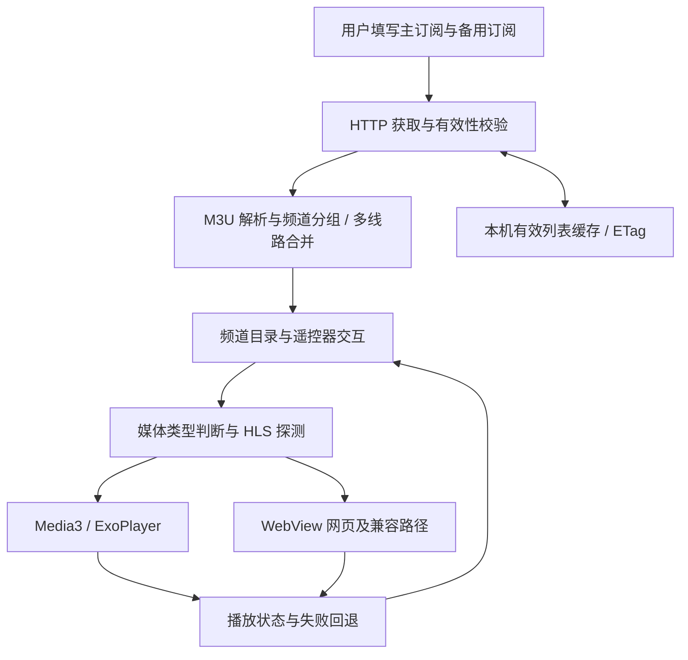

# Open TV

面向 Android 电视、电视盒子和投影设备的播放器改造项目，目标是用遥控器方便地播放**用户自行配置、且有权使用的内容**。也保留了触屏操作支持。

> **不提供直播源。** 本项目及维护者不提供、出售、代找或维护任何直播源表、订阅服务或节目内容。不会上传维护者私人使用的直播源表；主订阅地址和备用订阅地址均不预置。文档中的地址都是不可用的格式示例。
>
> **代码公开状态：待上游授权确认。** 当前仓库仅发布原创项目说明、配置指南及免责声明，**没有应用源码、APK 或可直接安装的发行版**。本地去源候选版已经准备；它基于 WebView 电视历史代码，而上游未找到明确的源码再分发许可证，因此暂不上传继承代码，也不将整个应用声明为 MIT、Apache 或其他标准开源许可。详见[授权状态](docs/LICENSING.md)。

[订阅配置](docs/SUBSCRIPTIONS.md) · [实现与开发](docs/DEVELOPMENT.md) · [隐私说明](docs/PRIVACY.md) · [免责声明](DISCLAIMER.md)

## 项目是做什么的

Open TV 把播放列表、频道选择和播放控制放在一个适合大屏操作的界面中。它不是内容服务，也不是采集站或视频转播服务器。

用户提供合法的 M3U 订阅后，应用按分组展示频道，并为同一个频道保留多条播放线路。直接媒体地址优先交给原生播放器；符合条件的网页或兼容路径由 WebView 处理。内容能否播放取决于用户提供的地址、内容方的访问条件、网络以及设备解码能力。

以下说明对应本地待授权候选版的实现，**不代表本仓库已经交付可用应用**。

## 已有能力

| 能力 | 实际行为 |
| --- | --- |
| 自定义订阅 | 主订阅和备用订阅均由用户填写；留空保持空白，不恢复任何隐藏默认地址 |
| M3U 解析 | 读取频道名称、`group-title` 和 HTTP(S) 地址；同组同名频道可合并多条线路 |
| 原生与网页播放 | Media3 / ExoPlayer 处理适配的媒体流；腾讯 X5 WebView 承担网页及部分兼容播放路径 |
| 线路切换 | 手动循环切换；播放失败或加载超时后尝试其他线路 |
| 订阅更新 | 启动、返回前台及前台定期检查；支持 ETag / HTTP 304 和上次有效列表缓存 |
| 大屏操作 | 遥控器选台、线路和比例设置；支持触屏选择、16:9 / 4:3 显示 |
| 调台取反 | 默认下键前进；打开后上键前进，菜单方向不随之反转 |
| 开机自启 | 默认关闭；启用后尝试在完整系统启动或重启后进入应用，不覆盖待机唤醒 |

## 怎么实现



界面和生命周期主要使用 Kotlin / Android 原生组件；网络请求使用 OkHttp；订阅更新任务使用协程。订阅失败时可以保留上次有效缓存；没有配置或没有有效列表时显示空频道状态，**不会从内置源表补齐**。新的有效频道目录可以延后到换台时应用，减少对正在播放内容的打断。

架构、构建条件与验证范围见[开发说明](docs/DEVELOPMENT.md)。

## 优点

- **内容配置独立。** 不绑定维护者的直播源、账号或私人订阅，主、备用地址均可自行控制。
- **适合电视遥控器。** 频道列表、线路切换、画面比例和方向反转适合大屏日常操作。
- **多条线路可以保留。** 同频道不同地址不会简单覆盖，线路失败后可以继续尝试。
- **兼顾直接媒体和网页。** 原生播放与 WebView 路径覆盖不同的内容形式。
- **减少重复拉取和播放打断。** 有效缓存、条件请求和目录延后生效用于改善订阅刷新体验。

## 缺点与边界

- **完整代码尚未公开。** 上游授权未明确前，不能从本仓库构建或安装应用。
- **没有即开即看的内容。** 用户必须自行取得合法有效的订阅；维护者不提供源表，也不承担找源服务。
- **不保证所有流和设备兼容。** 编码、容器、音轨、WebView 版本及厂商系统差异都可能导致黑屏、无声或加载失败。
- **WebView 路径较复杂。** 网页改版、脚本变化和内核差异可能影响播放；腾讯 X5 等第三方 SDK 还有各自的许可与隐私条款。
- **自启受系统约束。** 完整开机自启可能需要额外权限，厂商限制和用户强行停止应用等情况可能阻止启动；待机唤醒不属于此功能。
- **测试设备有限。** 历史私人版在 Android 11 投影设备上确认过音画和部分重启场景；这不等于去源候选版或所有设备均已实机验证，也不是长期稳定性承诺。
- **扩展播放列表能力有限。** 目前配置入口按频道 M3U 处理；没有承诺兼容 TVBox JSON、任意 TXT 列表、EPG、回看、录制或 DRM 授权集成。

## 如何配置订阅

代码获得适当授权并正式交付后，使用流程为：

1. 通过菜单键或长按确认键打开频道设置，再进入“应用设置”。
2. 在“订阅地址”填写你有权使用的 HTTP(S) **M3U 原始文本地址**并保存。
3. 可选填写“备用地址”。它是主订阅获取或校验失败时使用的另一份频道表，不是单条频道的备用播放线路。
4. 必要时选择“刷新频道列表”。没有任何预置订阅；清空主地址后进入未配置状态，清空备用地址后禁用订阅备用入口。

最小格式如下，地址不能用于播放：

```m3u
#EXTM3U
#EXTINF:-1 group-title="示例分组",示例频道
https://media.example.invalid/channel-a/index.m3u8
#EXTINF:-1 group-title="示例分组",示例频道
https://media.example.invalid/channel-a/backup.m3u8
```

完整的编码、字段、合并规则、大小限制和错误排查见[订阅配置指南](docs/SUBSCRIPTIONS.md)。项目不提供可用直播源表，示例也不指向任何实际频道或内容服务。

## 来源、许可与致谢

本项目基于 [WebView 电视 / WebViewTvLive](https://github.com/hxh19950701/WebViewTvLive) 的历史代码进行本地改造，感谢原作者及相关依赖维护者。**本项目与上游不是同一项目，也不表示上游认可本项目。**

截至 2026-11-17，本地工程及已核查的上游当前分支、历史标签未发现明确的项目级源码再分发许可证；上游 README 还写有学习交流、二次打包及非牟利方面的限制。因此保留待授权状态，不能用一份新许可证覆盖上游权利。

本仓库的原创说明文档按[文档许可](LICENSE-DOCUMENTATION.md)提供。该许可**不涉及应用代码、上游作品、第三方 SDK、商标或影音内容**。

文档编排参考了 [mytv-android](https://github.com/yaoxieyoulei/mytv-android) 对操作和订阅配置的分节方式，以及 [FongMi/TV](https://github.com/FongMi/TV) 对功能入口的简洁表达。仅借鉴组织思路，未复制其代码、直播源或项目特性。

## 免责声明与反馈

使用前请阅读[免责声明](DISCLAIMER.md)。软件代码、订阅数据和节目内容的权利相互独立；公开可访问不代表获得转载、传播、商业使用或再分发授权。

反馈请使用本仓库 [Issues](https://github.com/zhishixuebao-0791/Open-TV/issues)。请提供设备型号、系统版本、复现步骤和脱敏日志；**不要提交真实订阅地址、账号、访问令牌、私人频道表或受限节目内容**。本仓库不接受找源、售源或绕过内容访问限制的请求。
